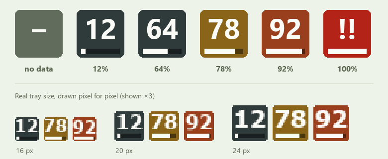
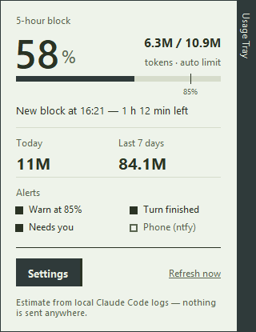
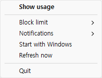
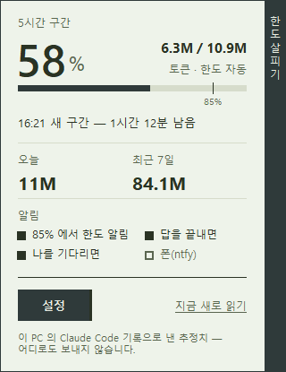
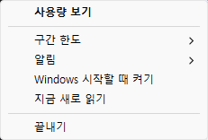

# Usage Tray

**Claude Code usage in your Windows tray — plus a ping when Claude finishes or needs you.**



The tray icon shows how much of your current 5-hour block you've used. Get a toast (and optionally a phone push) at 85%, when a turn is done, or when Claude Code is waiting for a permission.

**Download `UsageTray.exe` from [Releases](https://github.com/swbins/usage-tray/releases)** and run it — no install, no Python needed. Windows 10/11.

- **Meter** — percentage of the current 5-hour block right on the icon (ink → ochre → brick → red). The icon is drawn at the exact tray size (16 / 20 / 24 px…), so the digits stay sharp.
- **Card** — click the icon for the block %, used / limit, "new block at 16:00 — 1 h 12 min left", "at this pace you hit the limit at 15:40", today / last 7 days, and which alerts are on. Follows Windows light / dark mode.
- **Limit warning** — one toast at 75 / 85 / 95 % (your pick) and one at 100 %, per block.
- **Done / needs you** — adds two [Claude Code hooks](https://docs.claude.com/en/docs/claude-code/hooks) (`Stop`, `Notification`) with one menu click. The toast shows the project folder and the first line of Claude's last reply.
- **Phone** — optional [ntfy](https://ntfy.sh) topic; the same alerts arrive on your phone.
- **Private** — reads only `~/.claude/projects/**/*.jsonl` on your PC. No login token, no account, no telemetry. The only network call is ntfy, and only if you set a topic.

Click the icon:



Right-click (or **Settings** on the card) for settings:



## How the number is computed

Claude Code writes token usage for every reply into its local transcripts. Usage Tray groups replies into 5-hour blocks the same way [ccusage](https://github.com/ryoppippi/ccusage) does (a block starts at the hour of its first message; a 5-hour gap starts a new one) and counts input + output + cache-write tokens (cache reads optional).

Your plan's real limit isn't in those files, so the percentage is an **estimate**: by default against your biggest finished block of the last 8 days, or against a number you set (`Block limit → Set a number…`, e.g. `15M`).

## Hooks

`Notifications → Connect to Claude Code` adds this to `~/.claude/settings.json` (a backup is saved as `settings.json.usage-tray-backup`; your other hooks are kept):

```json
"Stop":         [{ "hooks": [{ "type": "command", "command": "curl -s -m 2 -X POST ... http://127.0.0.1:47615/hook/stop" }] }],
"Notification": [{ "hooks": [{ "type": "command", "command": "curl -s -m 2 -X POST ... http://127.0.0.1:47615/hook/notification" }] }]
```

The hook only posts to `127.0.0.1`. If the tray app isn't running, it fails silently in under 2 seconds. `Disconnect` removes exactly these two entries.

## Run from source

```
git clone https://github.com/swbins/usage-tray && cd usage-tray
pip install -r requirements.txt
pythonw -m usage_tray
python -m unittest tests.test_usage_tray
python -m usage_tray --preview --demo      # just the card, sample numbers (--dark, --lang ko, --shot out.png)
```

Build the exe yourself: `pip install pyinstaller && python build_exe.py` → `dist\UsageTray.exe`.

Settings live in `%APPDATA%\UsageTray\settings.json`. `Start with Windows` adds an `HKCU\...\Run` entry; untick it to remove.

MIT License. Not affiliated with or endorsed by Anthropic. Claude and Claude Code are trademarks of Anthropic, PBC.

---

## 한국어

**윈도우 작업 표시줄 트레이에 Claude Code 사용량 — 그리고 작업이 끝나거나 나를 기다릴 때 알림.**

[Releases](https://github.com/swbins/usage-tray/releases) 에서 `UsageTray.exe` 를 받아 실행하면 끝(설치·파이썬 필요 없음).

- 트레이 아이콘에 이번 5시간 구간을 몇 % 썼는지 숫자로(먹색 → 황토 → 벽돌 → 빨강). 트레이 크기 그대로 그려 16·20·24px 에서도 또렷합니다.
- 아이콘을 누르면 카드 한 장 — 구간 %, 쓴 양/한도, 「16:00 새 구간 — 1시간 12분 남음」, 「이 속도면 15:40 에 한도」, 오늘·최근 7일, 알림 상태. Windows 다크 모드면 어둡게.
- 75 / 85 / 95 % 중 고른 곳과 100 % 에서 한 번씩 알림.
- 메뉴 한 번으로 Claude Code 훅(`Stop`·`Notification`)을 넣어, 답이 끝나거나 권한 요청으로 기다리면 알림(프로젝트 폴더 + 마지막 답 첫 줄).
- 폰 알림은 [ntfy](https://ntfy.sh) 주제를 적으면.
- 이 PC 의 `~/.claude/projects` 기록만 읽습니다. 로그인 토큰·계정·통계 전송 없음.



설정은 오른쪽 클릭(또는 카드의 **설정**):



한도 % 는 추정치입니다 — 기본은 최근 8일 중 가장 많이 쓴 구간, 또는 직접 정한 숫자(예: `15M`) 기준.
